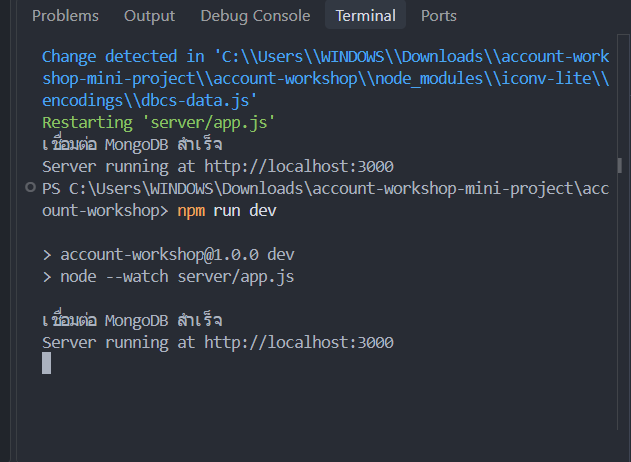
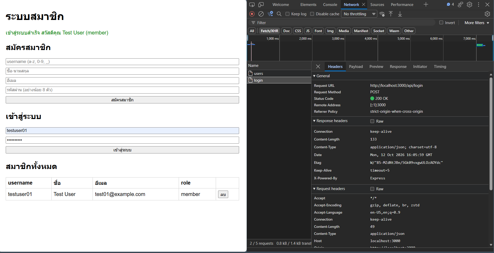

# Mini Project #2 — ระบบจัดการสมาชิก (Account Workshop)

เว็บแอปพลิเคชันตัวอย่างสำหรับสมัครสมาชิก เข้าสู่ระบบ ดูรายชื่อ และลบสมาชิก ใช้ **Node.js + Express.js** เป็น Backend, **HTML + JavaScript** เป็น Frontend และ **MongoDB** เก็บข้อมูลในฐานข้อมูล `account-db` collection `users` โดยเก็บรหัสผ่านแบบ bcrypt hash

> **ข้อจำกัดสำคัญ:** โค้ดนี้เป็นเวิร์กช็อปสำหรับทดลองบนเครื่องเท่านั้น: `GET /api/users` และ `DELETE /api/users/:username` ยังไม่ได้ตรวจสอบสิทธิ์ และการ login ยังไม่ได้สร้าง session/token ห้ามนำขึ้นเซิร์ฟเวอร์สาธารณะหรือใช้ข้อมูลจริงโดยไม่เพิ่ม authentication/authorization ก่อน

## โครงสร้าง

```text
account-workshop/
├── server/app.js         # Express API + MongoDB
├── public/index.html     # หน้าเว็บ
├── public/script.js      # เรียก API ด้วย fetch
├── screenshots/          # ภาพดีบักที่ผู้จัดทำต้องถ่ายเอง
├── .env.example
├── .gitignore
├── package.json
└── README.md
```

## ติดตั้งและใช้งาน

1. ติดตั้ง Node.js รุ่นที่รองรับ MongoDB driver 7 (แนะนำ Node.js 22 LTS หรือใหม่กว่า) และ MongoDB Community Server
2. เปิด MongoDB ในเครื่องที่ `mongodb://127.0.0.1:27017` หรือกำหนดตัวแปร `MONGO_URL` ให้ตรงกับเซิร์ฟเวอร์ของคุณ
3. เปิด Terminal ที่โฟลเดอร์หลักของโปรเจกต์ แล้วรัน:

```bash
npm install
npm run dev
```

4. เปิด `http://localhost:3000` ในเบราว์เซอร์ (ค่าเริ่มต้น `PORT=3000`)

หากไม่ใช้ watch mode รัน `npm start` ได้เช่นกัน

## API endpoints

| Method | Endpoint | คำอธิบาย |
| --- | --- | --- |
| POST | `/api/register` | สมัครสมาชิก ส่ง JSON `username`, `name`, `email`, `password` |
| POST | `/api/login` | เข้าสู่ระบบ ส่ง JSON `username`, `password` |
| GET | `/api/users` | ดึงรายชื่อสมาชิก (ไม่ส่ง `passwordHash`) |
| DELETE | `/api/users/:username` | ลบสมาชิกตาม username |

ตัวอย่าง JSON สำหรับ `POST /api/register`:

```json
{"username":"student01","name":"Student One","email":"student01@example.com","password":"examplepass123"}
```

## หลักฐานการดีบัก 2 ภาพ (ต้องเพิ่มจากการรันจริง)

1. **ภาพที่ 1**: Terminal แสดง `เชื่อมต่อ MongoDB สำเร็จ` และ `Server running at http://localhost:3000`
2. **ภาพที่ 2**: หน้าจอ Browser แสดงผลสมัครสมาชิกและรายชื่อสมาชิก หรือ Network tab ที่เห็น API สำเร็จ

เมื่อถ่ายภาพแล้ว ให้บันทึกเป็น `screenshots/debug-1.png` และ `screenshots/debug-2.png` และแทนที่บรรทัดด้านล่างด้วยภาพจริง (ไม่ควรส่งงานโดยไม่มีภาพ)





## หมายเหตุ

- ข้อมูลใน MongoDB เป็นข้อมูลภายในเครื่องและไม่ถูกอัปโหลดไปกับ GitHub
- ห้าม commit `.env`, รหัสผ่าน หรือ `node_modules`
- ต้องทดลองรันระบบและถ่ายภาพหลักฐานจริงก่อนส่งงาน
